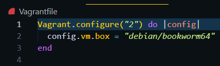
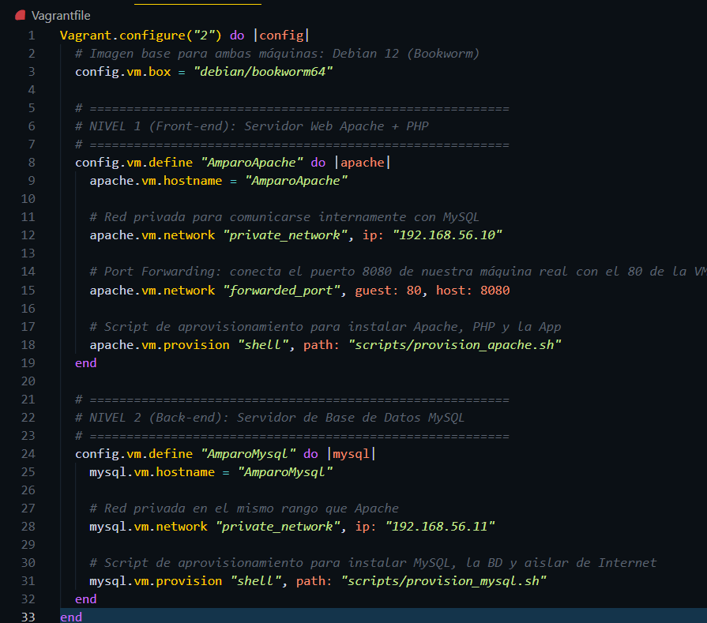
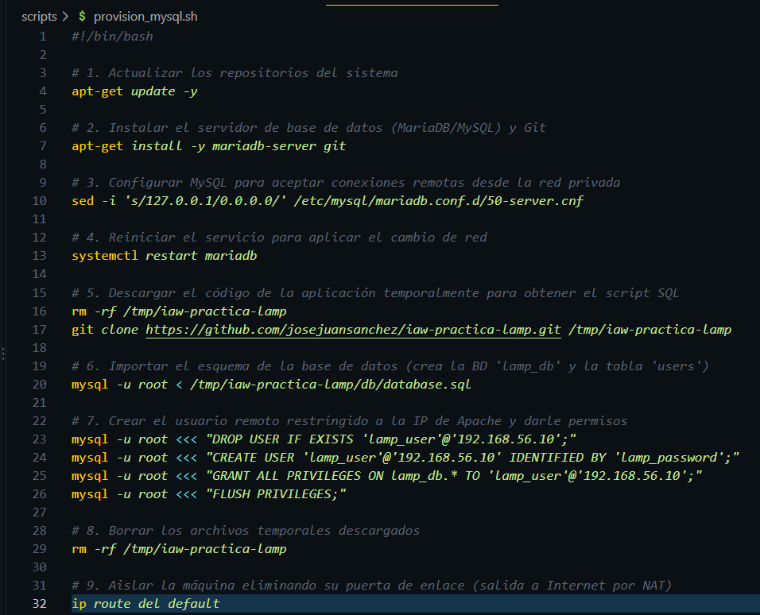
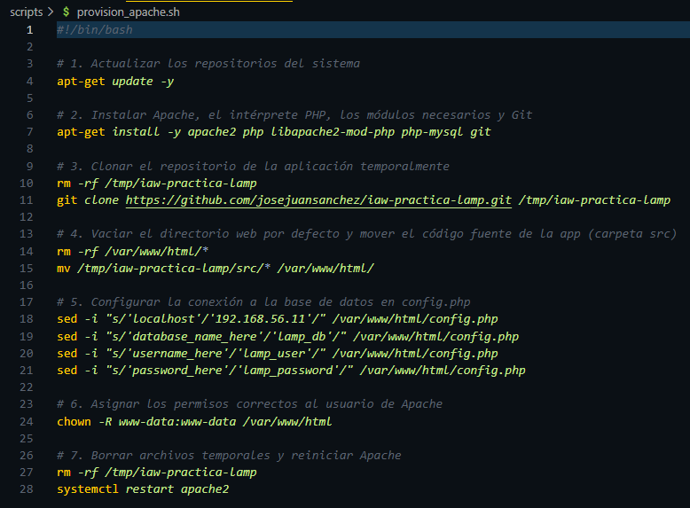
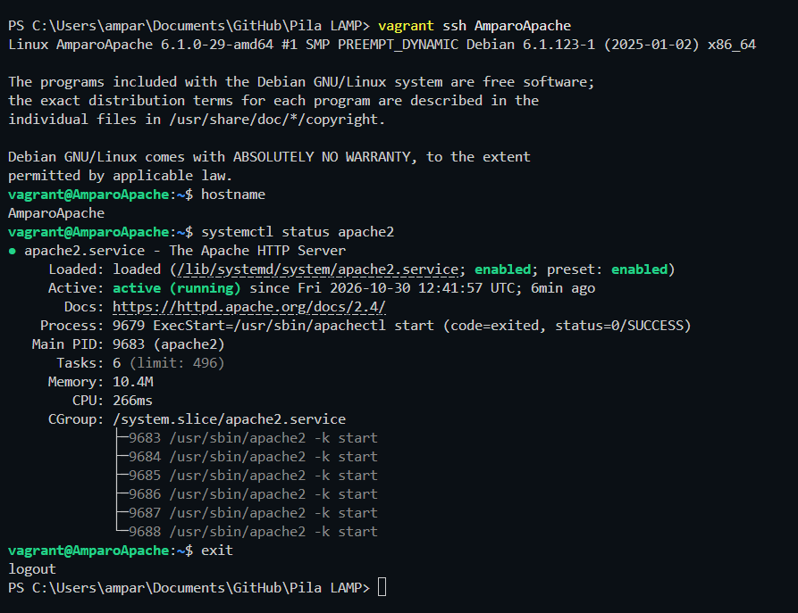
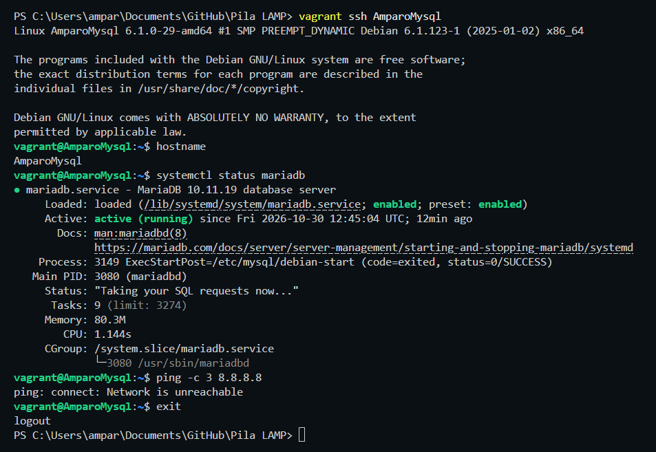
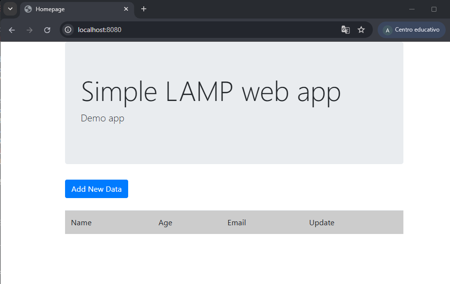
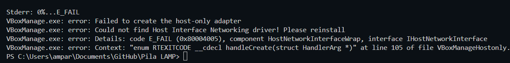

# **Pila LAMP en dos niveles**
##### _Amparo Sánchez Ledo - ASIR 2 - 29/10/2026_

Antes de comenzar a montar la infraestructura en dos niveles, vamos a ver qué es la **[Pila LAMP](https://aws.amazon.com/es/what-is/lamp-stack/)**.

En pocas palabras, la **Pila LAMP** es el _conjunto de tecnologías de diferentes softwares utilizados para crear sitios web y aplicaciones web_, de manera que permiten que el **front-end** (la web, por ejemplo) se conecte con el **back-end** (la base de datos). Si desglosamos la palabra **LAMP**, obtendremos las 4 tecnologías:

- **L (Linux)**: Sistema operativo (en el caso de esta infraestructura, **[Debian 12](https://www.debian.org/releases/bookworm/index.es.html)**) que hace de suelo para todo.

- **A (Apache)**: El intermediario (Servidor web), es decir, cuando tú entras al navegador, éste se encarga de atender y mostrar la página (front-end).

- **M (MySQL)**: Almacena datos (Base de datos). Aquí se guardan los usuarios, contraseñas y datos reales (back-end).

- **P (PHP)**: Se encarga de traducir o enviar mensajes. Apache solamente sabe mostrar las páginas y no sabe hablar con la base de datos, así que usa el código PHP para poder pedir datos a MySQL, procesarlos y entregarlos a Apache convertidos en una web y sus estilos.

Una vez vista la definición de **Pila LAMP**, comenzamos a crear la infraestructura.


---

## **_Requisitos previos_**

> **Nota importante**: En caso de que se disponga de las herramientas anteriores y el entorno de VSCode + Vagrant + VirtualBox ya configurados, saltar este punto.

### **_1. Instalación de requisitos previos_**
Para realizar la infraestructura, tendremos en cuenta la instalación de las siguientes herramientas y dónde instalarlas:

- **VirtualBox** en su sitio oficial: [enlace](https://www.virtualbox.org/wiki/Downloads).

- **Paquete de Vagrant** desde la web oficial de HashiCorp: [enlace](https://developer.hashicorp.com/vagrant/downloads).

- **VSCode** en su sitio oficial: [enlace](https://code.visualstudio.com/download).

### **_2. Preparación del entorno en VSCode_**
Para preparar **VSCode**, seguiremos los siguientes pasos:

1. Abrimos el proyecto en la carpeta que hayamos creado (donde se encuentra el README.md)

2. Instalamos la extensión de ayuda (opcional pero recomendado), pues el archivo de Vagrant está escrito en **[Ruby](https://www.oracle.com/es/developer/what-is-ruby-for-developers/)** y VSCode tiene la opción de colorear el código, así que en extensiones instalaremos **Vagrantfile Support**.

3. Con Ctrl + Ñ abriremos la terminal integrada y comprobaremos las versiones:

    ```bash
    vagrant --version
    vboxmanage --version
    ```

En mi caso, tengo las siguientes versiones:


---

## **_1. Creación e inicialización de la infraestructura_**

Comenzamos la tarea inicializando nuestro proyecto y creando el Vagrantfile. Para esto, usaremos **[Debian 12](https://www.debian.org/releases/bookworm/index.es.html)** (cuyo nombre clave oficial es _Bookworm_). En vez de crear el archivo desde cero, usaremos el comando oficial de Vagrant para que genere la estructura inicial en nuestra carpeta.

En la terminal de VSCode ejecutaremos `vagrant init debian/bookworm64`

> **Explicación**: en el momento donde hemos lanzado **`vagrant init`** hemos hecho que Vagrant cree automáticamente un archivo en la carpeta llamado Vagrantfile, el cual está preconfigurado con la imagen oficial de **debian/bookworm64**.

Debemos revisar que el Vagrantfile creado anteriormente tiene varias líneas comentadas (podemos eliminarlas, sirven de guía) y solamente _3 activas_:
```ruby
Vagrant.configure("2") do |config|
  config.vm.box = "debian/bookworm64"
end
```

La siguiente captura muestra el **Vagrantfile** creado:



---

## **_2. Diseño de la arquitectura (Vagrantfile)_**

Ahora que ya disponemos del archivo **Vagrantfile** totalmente limpio, vamos a editarlo para que pueda levantar nuestras dos máquinas.

> INFORMACIÓN SOBRE EL CÓDIGO ESCRITO A CONTINUACIÓN
> ---
>
>Debemos tener en cuenta 4 piezas claves:
>
> 1. **Multi-Machine (`config.vm.define`)**: Al usar dos servidores separados (**front-end y back-end**), usamos esta orden para poder dividir el archivo en dos bloques: uno para la máquina de **Apache** y otro para la de **MySQL**.
>
> 2. **Identidad (`hostname`)**: El nombre que le ponemos a las máquinas es totalmente a la elección de cada uno, para que cuando entremos a la terminal y veamos el prompt, éste dirá **vagrant@usuarioApache** y **vagrant@usuarioMysql** (en mi caso: **vagrant@AmparoApache** y **vagrant@AmparoMysql**).
>
> 3. **Red privada (`private_network`)**: Para hacer que Apache pida datos a MySQL _sin pasar por Internet_, conectaremos ambas máquinas simulando un "cable directo", creando una red local privada donde:
>       - **IP Apache**: `192.168.56.10`
>       - **IP MySQL**: `192.168.56.11`
>
> 4. **Reenvío de puertos (`forwarded_port`)**: el servidor Apache escuchará en su puerto `80` (estándar de las webs). Al estar en una máquina virtual y que se pueda ver desde el navegador del anfitrión, le diremos a Vagrant que todo lo que entre por el puerto `8080` del PC real, lo mande directamente al `80` del servidor Apache.

### **_2.1 Crear la carpeta de los scripts_**

Primero crearemos una carpeta llamada **scripts** donde alojaremos dos archivos vacíos por ahora llamados **`provision_apache.sh`** y **`provision_mysql.sh`**


### **_2.2 Editar el VagrantFile_**

Ya creadas las carpetas, nos iremos al Vagrantfile y borramos las 3 líneas actuales, reemplazándolas por la siguiente configuración completa:

```ruby
Vagrant.configure("2") do |config|
  # Imagen base para ambas máquinas: Debian 12 (Bookworm)
  config.vm.box = "debian/bookworm64"

  # =========================================================
  # NIVEL 1 (Front-end): Servidor Web Apache + PHP
  # =========================================================
  config.vm.define "UsuarioApache" do |apache|
    apache.vm.hostname = "UsuarioApache"
    
    # Red privada para comunicarse internamente con MySQL
    apache.vm.network "private_network", ip: "192.168.56.10"
    
    # Port Forwarding: conecta el puerto 8080 de nuestra máquina real con el 80 de la VM
    apache.vm.network "forwarded_port", guest: 80, host: 8080
    
    # Script de aprovisionamiento para instalar Apache, PHP y la App
    apache.vm.provision "shell", path: "scripts/provision_apache.sh"
  end

  # =========================================================
  # NIVEL 2 (Back-end): Servidor de Base de Datos MySQL
  # =========================================================
  config.vm.define "UsuarioMysql" do |mysql|
    mysql.vm.hostname = "UsuarioMysql"
    
    # Red privada en el mismo rango que Apache
    mysql.vm.network "private_network", ip: "192.168.56.11"
    
    # Script de aprovisionamiento para instalar MySQL, la BD y aislar de Internet
    mysql.vm.provision "shell", path: "scripts/provision_mysql.sh"
  end
end
```

> **Recordatorio**: Cambiar los apartados donde pone **usuario** por el nombre que queramos poner.

La siguiente captura muestra el ejemplo de mi Vagrantfile:



---

## **_3. Aprovisionamiento del Back-end (MySQL)_**

Pasamos a programar el script que instalará la base de datos en la máquina de **MySQL**.

En nuestro caso al usar **[Debian 12](https://www.debian.org/releases/bookworm/index.es.html)**, el paquete oficial de MySQL lo instalaremos a través de **[MariaDB](https://mariadb.org/) (`mariadb-server`)**. Además, con el uso de este repositorio de **[GitHub](https://github.com/josejuansanchez/iaw-practica-lamp)** desplegaremos la aplicación de ejemplo (gestión de usuarios), importando el archivo **`database.sql`** que crea la base de datos **`lamp_db`** y la tabla de usuarios automáticamente.

Para ello, abriremos nuestro archivo **`provision_mysql.sh`** creado anteriormente en la carpeta de **scripts** y pegaremos el siguiente código:

```bash
#!/bin/bash

# 1. Actualizar los repositorios del sistema
apt-get update -y

# 2. Instalar el servidor de base de datos (MariaDB/MySQL) y Git
apt-get install -y mariadb-server git

# 3. Configurar MySQL para aceptar conexiones remotas desde la red privada
sed -i 's/127.0.0.1/0.0.0.0/' /etc/mysql/mariadb.conf.d/50-server.cnf

# 4. Reiniciar el servicio para aplicar el cambio de red
systemctl restart mariadb

# 5. Descargar el código de la aplicación temporalmente para obtener el script SQL
rm -rf /tmp/iaw-practica-lamp
git clone https://github.com/josejuansanchez/iaw-practica-lamp.git /tmp/iaw-practica-lamp

# 6. Importar el esquema de la base de datos (crea la BD 'lamp_db' y la tabla 'users')
mysql -u root < /tmp/iaw-practica-lamp/db/database.sql

# 7. Crear el usuario remoto restringido a la IP de Apache y darle permisos
mysql -u root <<< "DROP USER IF EXISTS 'lamp_user'@'192.168.56.10';"
mysql -u root <<< "CREATE USER 'lamp_user'@'192.168.56.10' IDENTIFIED BY 'lamp_password';"
mysql -u root <<< "GRANT ALL PRIVILEGES ON lamp_db.* TO 'lamp_user'@'192.168.56.10';"
mysql -u root <<< "FLUSH PRIVILEGES;"

# 8. Borrar los archivos temporales descargados
rm -rf /tmp/iaw-practica-lamp

# 9. Aislar la máquina eliminando su puerta de enlace (salida a Internet por NAT)
ip route del default
```

> EXPLICACIÓN DEL CÓDIGO
> ---
> Aunque tengamos comentado el código para saber qué hace cada línea, vamos a desglosarlo y analizar cada una de estas:
>
> - **`#!/bin/bash` (shebang)**: Indica al sistema Linux que el archivo debe ejecutarse usando el intérprete de comandos **Bash**.
>
> - **`apt-get update -y`**: Actualiza el listado de paquetes disponibles sin pedir confirmación **(`-y`)**.
>
> - **`apt-get install -y mariadb-server git`**: Instala el gestor de base de datos y la herramienta **Git**.
>
> - **`sed -i 's/127.0.0.1/0.0.0.0/'...:'`**: Por defecto, el parámetro **`bind-address`** viene configurado en **`127.0.0.1`**. Con **`sed -i`** buscamos ese texto y lo sustituimos automáticamente por **`0.0.0.0`** en el archivo de configuración para que pueda escuchar peticiones desde cualquier tarjeta de red.
>
> - **`systemctl restart mariadb`**: Reinicia el servicio de la base de datos para que el cambio del **`bind-address`** haga efecto.
> - **`git clone ... /tmp/iaw-practica-lamp`**: Clona el repositorio de la aplicación web de ejemplo en la carpeta temporal (**`/tmp`**).
>
> - **`mysql -u root < .../database.sql`**: Usa el operador de dirección **`<`** para inyectar el script SQL del proyecto directamente en el motor de la base de datos, creándola junto a su tabla de usuarios.
>
> - **`mysql -u root <<< "..."`**: Usa la redirección **_Here String_** (**`<<<`**) para ejecutar sentencias SQL directamente desde Bash:
>
>   - _`DROP USER IF EXISTS`_: Elimina el usuario si existía de una ejecución previa para evitar errores. 
>
>   - _`CREATE USER 'lamp_user'@'192.168.56.10' IDENTIFIED BY 'lamp_password'`_: Crea el usuario de trabajo especificando que puede conectarse solo desde la IP privada de la máquina Apache (**`192.168.56.10`**)
>
>   - _`GRANT ALL PRIVILEGES ON lamp_db.*`_: Da permisos totales al usuario exclusivamente sobre las tablas de las bases de datos.
>
>   - _`FLUSH PRIVILEGES`_: Recarga las tablas de permisos en memoria para aplicar los cambios en el momento.
>
> - **`ip route del default`**: Elimina la ruta por defecto de la tabla de enrutamiento. Ya instalados los paquetes, este comando corta conexiones hacia el exterior, garantizando que la máquina quede aislada de **Internet** pero manteniendo activa su red privada (**`192.168.56.0/24`**).

La siguiente captura, muestra mi **`provision_mysql.sh`**:



---

## **_4. Aprovisionamiento del Front-end (Apache y PHP)_**

En este punto, instalaremos el servidor web, el intérprete de **PHP** y los **módulos de conexión**. Además, realizaremos los ajustes en el código de la aplicación para que apunte a la IP de la máquina MySQL.

Para ello, abriremos el archivo **`provision_apache.sh`** de la carpeta **scripts** y pegaremos el siguiente código:

```bash
#!/bin/bash

# 1. Actualizar los repositorios del sistema
apt-get update -y

# 2. Instalar Apache, el intérprete PHP, los módulos necesarios y Git
apt-get install -y apache2 php libapache2-mod-php php-mysql git

# 3. Clonar el repositorio de la aplicación temporalmente
rm -rf /tmp/iaw-practica-lamp
git clone https://github.com/josejuansanchez/iaw-practica-lamp.git /tmp/iaw-practica-lamp

# 4. Vaciar el directorio web por defecto y mover el código fuente de la app (carpeta src)
rm -rf /var/www/html/*
mv /tmp/iaw-practica-lamp/src/* /var/www/html/

# 5. Configurar la conexión a la base de datos en config.php
sed -i "s/'localhost'/'192.168.56.11'/" /var/www/html/config.php
sed -i "s/'database_name_here'/'lamp_db'/" /var/www/html/config.php
sed -i "s/'username_here'/'lamp_user'/" /var/www/html/config.php
sed -i "s/'password_here'/'lamp_password'/" /var/www/html/config.php

# 6. Asignar los permisos correctos al usuario de Apache
chown -R www-data:www-data /var/www/html

# 7. Borrar archivos temporales y reiniciar Apache
rm -rf /tmp/iaw-practica-lamp
systemctl restart apache2
```

> EXPLICACIÓN DEL CÓDIGO
> ---
> Al igual que hemos hecho con el código del script **`provision_mysql.sh`**, desglosaremos el código y veremos que hace cada línea:
>
> - **`#!/bin/bash` (shebang)**: Indica al sistema Linux que el archivo debe ejecutarse usando el intérprete de comandos **Bash**.
>
> - **`apt-get install -y apache2 php libapache2-mod-php php-mysql git`**: Instala el servidor web Apache, el intérprete de PHP, el módulo que permite servir páginas PHP desde Apache y el módulo para que PHP pueda conectarse a bases de datos MySQL.
>
> - **`rm -rf /var/www/html/*`**: Elimina el archivo **`index.html`** por defecto que incluye Apache en su instalación.
>
> - **`mv /tmp/iaw-practica-lamp/src/* /var/www/html/`**: Mueve solo el código fuente de la aplicación (carpeta **`/src`**) al directorio **DocumentRoot** por defecto de Apache (**`/var/www/html`**)
>
> - **`sed -i "..." /var/www/html/config.php`**: Hace los ajustes necesarios en la aplicación para hacerla funcional. El archivo **`config.php`** tiene definidas las constantes de conexión. Con el comando **`sed`**, reemplazamos **localhost** por la IP privada de nuestra base de datos (**`192.168.56.11`**) y rellenamos las credenciales (**lamp_db, lamp_user, lamp_password**)
>
> - **`chown -R www-data:www-data /var/www/html`**: Cambia el propietario de todo el directorio web al usuario y grupo **www-data**, que es la cuenta con la que se ejecuta el servicio de Apache.
>
> - **`systemctl restart apache2`**: Reiniciamos el servicio del servidor web para asegurar que todos los módulos PHP instalados cargan correctamente.

La siguiente captura, muestra mi **`provision_apache.sh`**:




---

## **_5. Comprobación del funcionamiento de la infraestructura_**

Una vez ya editados y guardados ambos scripts (**`provision_mysql.sh` y `provision_apache.sh`**), en la terminal de VSCode (que como dije anteriormente, es la que uso en mi caso) con **Ctrl + Ñ** y ejecutaremos **`vagrant up`**.

**_¿Qué pasará si hacemos esto?_**

Básicamente, ambas máquinas se descargarán, configurarán y ejecutarán los scripts de manera totalmente automática.

Para las comprobaciones de que ambos entornos se ha configurado correctamente, ejecutaremos los siguientes comandos (según la máquina):

### **_5.1 Comprobación de la máquina Front-end (Apache)_**

  - Entramos en la máquina escribiendo **`vagrant ssh UsuarioApache`** (dependiendo del nombre que se le haya puesto en el **Vagrantfile**)

  - Ejecutamos **`hostname`** para demostrar el nombre que le hemos puesto.

  - Usamos **`systemctl status apache2`** para ver que el servidor está encendido (**`active (running)`**)

  - Salimos con **`exit`**



### **_5.2 Comprobación de la máquina Back-end (MySQL)_**

  - Entramos a la máquina con **`vagrant ssh UsuarioMysql`**
  - Ejecutamos **`hostname`** para ver el nombre que hemos puesto.

  - Escribimos **`systemctl status mariadb`** para demostrar que la base de datos está corriendo (**`active (running)`**)

  - Hacemos un **ping** con **`ping -c 3 8.8.8.8`** para demostrar el aislamiento estricto de red, de manera que tiene que devolver un error como **`Network is unreachable`** o quedarse bloqueado para confirmar el corte con Internet.

  - Salimos con **`exit`**



### **_5.3 Comprobación de la aplicación (navegador)_**

  - Abrimos el navegador que usamos habitualmente en nuestro ordenador anfitrión.

  - Escribimos la dirección **`http://localhost:8080`**



---

## **_Screencast_**

A continuación, un vídeo de demostración del funcionamiento de ambos entornos y una creación de registro en la aplicación: **[Enlace](screencast/Pila%20LAMP.mp4)**

---

## **_Incidencias_**

#### **_Incidencia 1_**

Al ejecutar el comando **`vagrant up`** ha salido un error en la terminal que devuelve el siguiente mensaje:



> **Causa**: Esto se debe a que el sistema operativo anfitrión (en mi caso Windows) bloquea por motivos de seguridad la creación automática de la red privada virtual, o el controlador de red de VirtualBox no está instalado correctamente.

> **Solución**: Se crea un nuevo Adaptador de Red. Para ello, abrimos **VirtualBox** y vamos a **Archivo > Herramientas > Red > Crear**.

En caso de que la creación nos devuelva error por falta de controladores: 

1. Accedemos a la ruta de VirtualBox **`C:\Archivos de programa\Oracle\VirtualBox\drivers\network\netadp6`**

2. Hacemos clic derecho sobre el archivo **`VBoxNetAdp6.inf`** y seleccionamos **Instalar** (aceptando permisos de administrador)

3. Volvemos a intentar crear de nuevo el Adaptador de Red.

Si ya se nos ha creado correctamente, ejecutaremos de nuevo en la terminal de **VSCode** el comando **`vagrant up`**.

#### **_Incidencia 2_**

Al acceder a **`http://localhost:8080`** no encontraba la página.

> **Detalle**: En esta incidencia se me ha olvidado hacer captura, pero es básicamente la típica pantalla de **"Página no encontrada"**.

> **Causa**: Aunque el navegador mostraba el error de página no encontrada, el servidor web y los archivos estaban bien configurados. Esto se debe a un error interno de la aplicación al conectar con el **Back-end** y cortaba la comunicación.

> **Solución**: Hay que crear la base de datos de manera manual directamente en el servidor MySQL:
>
> 1. Accede a la máquina con **`vagrant ssh UsuarioMysql`** (recordatorio que varía según el nombre insertado)
>
> 2. Entrar con **`sudo mysql -u root`** a la consola de **MariaDB**
>
> 3. Escribir las siguientes sentencias SQL para estructurar la aplicación:
>
>   ```SQL
>   CREATE DATABASE IF NOT EXISTS lamp_db;
>   USE lamp_db;
>   CREATE TABLE IF NOT EXISTS users (
>     id int(11) NOT NULL AUTO_INCREMENT,
>     name varchar(100) NOT NULL,
>     age int(3) NOT NULL,
>     email varchar(100) NOT NULL,
>     PRIMARY KEY (id)
>   );
> ```
> **Nota**: Debemos comprobar que al lado de MariaDB ponga **`[lamp_db]`**

---

## **_Fuentes consultadas_**

- **Apuntes de clase proporcionados**

- **[Amazon Web Services (AWS)](https://aws.amazon.com/es/what-is/lamp-stack/)**

- **[Documentación oficial de HashiCorp Vagrant](https://developer.hashicorp.com/vagrant/docs)**

- **[Repositorio de GitHub para la aplicación web de ejemplo (iaw-practica-lamp)](https://github.com/josejuansanchez/iaw-practica-lamp)**

- **[Documentación oficial de MariaDB](https://mariadb.org/documentation/)**
